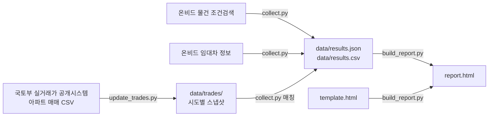

# 온비드 공매 아파트 저평가 스크리너

온비드의 아파트 공매 최저입찰가를 국토부 실거래가와 비교해, 시세보다 싸게 나온 물건을 골라 보는 단일 페이지 리포트입니다.

- API 키, 로그인, LLM API를 쓰지 않습니다. 파이썬 3.11 표준 라이브러리만 사용합니다.
- 결과물은 데이터가 들어 있는 HTML 한 파일(`report.html`)과 같은 내용의 표(`data/results.csv`)입니다.
- 1차 선별용이며 투자 권유가 아닙니다. 권리분석은 자동화하지 않습니다.

## 목차
1. [빠른 시작](#빠른-시작)
2. [구성과 데이터 흐름](#구성과-데이터-흐름)
3. [파일별 설명](#파일별-설명)
4. [매칭 방법](#매칭-방법)
5. [데이터 형식](#데이터-형식)
6. [설정값과 바꾸는 법](#설정값과-바꾸는-법)
7. [GitHub Actions](#github-actions)
8. [다른 용도로 재사용하기](#다른-용도로-재사용하기)
9. [알려진 한계와 개선 과제](#알려진-한계와-개선-과제)
10. [수정 후 확인 방법](#수정-후-확인-방법)
11. [문제 해결](#문제-해결)

## 빠른 시작

리포트만 볼 때:

```
report.html 을 더블클릭
```

데이터를 새로 받을 때(PC, 한국 IP 권장):

```
git pull
python update_trades.py     # 국토부 실거래 스냅샷 (7일 지난 시도만 다시 받음, 전부 받으면 약 100MB 수신)
python collect.py           # 온비드 수집 + 매칭 (약 3분)
python build_report.py      # report.html 생성
```

## 구성과 데이터 흐름



- 실거래 수집(`update_trades.py`)과 공매 수집·매칭(`collect.py`)이 나뉘어 있습니다. `collect.py`는 국토부에 접속하지 않고 `data/trades/`만 읽습니다.
- 할인율 같은 숫자는 파이썬에서 계산해 `results.json`에 넣고, `template.html`은 필터·정렬·그리기만 합니다.
- 저장소에 올리는 것: 코드, `data/results.json`, `data/results.csv`, `data/trades/`, `report.html`. 올리지 않는 것: `data/onbid_raw.json`(다시 받을 수 있는 원본).

## 파일별 설명

| 파일 | 역할 | 접속하는 곳 |
|---|---|---|
| `update_trades.py` | 국토부 아파트 매매 실거래(최근 364일, 계약 해제 건 제외)를 시도별로 받아 `data/trades/<시도>.csv.gz`로 저장 | rt.molit.go.kr |
| `collect.py` | 온비드 아파트 공매 회차(앞으로 95일) 수집, 물건 단위로 묶기, 실거래 매칭, 압류재산 임대차 정보 수집 | onbid.co.kr |
| `build_report.py` | `data/results.json`을 `template.html`의 `/*__DATA__*/null` 자리에 넣어 `report.html` 생성 | 없음 |
| `template.html` | 화면: 산점도, 상위 15건 막대, 정렬되는 표. 외부 의존 없음 | 없음 |

### collect.py의 흐름
1. `fetch_onbid()`: 조건검색 화면이 쓰는 목록 주소에 용도(아파트)와 입찰기간을 넣어 회차 목록을 받습니다. 한 행이 "회차" 하나입니다.
2. `group_items()`: 같은 물건(`onbidCltrno`)의 회차를 묶어, 아직 마감되지 않은 가장 가까운 회차를 "현재 회차"로, 예정된 회차 중 최저가를 "마지막 회차"로 잡습니다. 매각 물건만 남깁니다.
3. `match()`: 아래 [매칭 방법](#매칭-방법)대로 시세를 붙입니다.
4. `fetch_leases()`: 압류재산이면서 시세가 붙은 물건만 임대차 정보를 읽어, 신고된 보증금을 전액 인수하는 최악의 경우 할인율(`disc_worst`)을 계산합니다.
5. `flags()`: 물건명에서 주의 표시(지분, 저층, 여러 필지, 유찰 5회 이상)를 뽑습니다.

### 종료 코드
| 코드 | 뜻 | GitHub Actions의 처리 |
|---|---|---|
| 0 | 정상 | 커밋 |
| 75 | 대상 사이트에 접속하지 못함(코드 오류가 아님) | 새 러너에서 재시도 |
| 1 | 오류, 또는 스냅샷이 너무 오래됨 | 실패로 표시 |

## 매칭 방법

`collect.py`의 `match()`가 물건 하나를 실거래와 맞추는 순서입니다.

1. **주소 정리** (`norm_name()`): 물건명 앞의 `(16)` 같은 번호를 떼고, `경기` 같은 줄임 시도명을 `경기도`로 바꿉니다.
2. **시군구·동 찾기**: 물건명 앞부분과 일치하는 가장 긴 실거래 시군구 문자열을 찾습니다. 못 찾으면 온비드가 준 지역(`sidoSgkEmd`)과 그 뒤의 리 이름으로 다시 찾습니다(옛 시도명, 구 생략 표기 대응).
3. **지번 맞추기** (`norm_bunji()`): 주소 뒤의 지번을 `본번-부번`으로 정규화해 같은 지번의 거래만 봅니다.
4. **면적 맞추기**:
   - 전용면적이 ±1㎡ 안인 거래가 있으면 `exact`. 최근 6개월 거래가 3건 이상이면 그 구간, 아니면 최근 1년의 중앙값을 시세로 씁니다.
   - 없으면 같은 지번에서 면적이 ±20% 안인 거래의 ㎡당 가격 중앙값 × 물건 면적을 시세로 쓰고 `approx`로 표시합니다.
   - 그것도 없으면 `none`이고 이유(`why`)를 남깁니다.
5. **할인율**: `disc_cur = 1 − 현재 최저입찰가 ÷ 시세`. `disc_worst = 1 − (최저입찰가 + 신고 보증금 합) ÷ 시세`.

층·향·수리 상태는 반영하지 않습니다.

## 데이터 형식

### data/results.json
```
meta:  collected_at, bid_from, bid_to, trade_from, trade_to, trade_saved,
       rounds(회차 수), items(물건 수), exact, approx, none
items: [{
  id, name, region, sido, asset_type, seller, dispose, area, land_area, appraisal,
  fail_count, views, status,
  cur_price, cur_round, cur_begin, cur_end, last_price, last_end,
  rounds[{end, price}], keys{온비드 상세 조회용 번호들}, url,
  match("exact" | "approx" | "none"), why(none일 때),
  complex, built, market, market_basis, n, lo, hi, last_date, trades[{date, price, area, floor}],
  disc_cur, disc_last, gap_cur, disc_worst(보증금이 공개된 경우만),
  lease{ok, count, deposit_sum, deposit_unknown, tenants[{kind, deposit, rent, fixed, movein}]},
  flags[]
}]
```
- 금액은 모두 원 단위입니다.
- `asset_type`은 온비드의 재산유형(압류재산, 기타일반재산, 국유재산, 공유재산 등)입니다. 임대차 정보는 압류재산에만 있습니다.

### data/trades/
- `<시도>.csv.gz`: 열은 `sgg, bunji, date, price_man, area, floor, complex, built, deal`. 계약 해제 건은 빠져 있습니다.
- `meta.json`: 시도별 `saved_at, trade_from, trade_to, rows`. 갱신 여부는 `saved_at` 기준입니다.
- `sidos.json`: 국토부가 알려 준 시도 이름 목록. 이 목록의 스냅샷이 모두 최신이면 접속하지 않고 끝냅니다.
- gzip은 `mtime=0`으로 써서 내용이 같으면 파일도 같습니다.

## 설정값과 바꾸는 법

| 바꾸고 싶은 것 | 고칠 곳 |
|---|---|
| 입찰기간 범위 | `collect.py`의 `BID_TO` (기본 오늘 + 95일) |
| 물건 종류 | `APT_CTGR_ID`(아파트 10201). 다른 용도는 온비드 조건검색 화면의 용도 분류 번호를 넣고, 실거래도 그 유형으로 받아야 합니다(`update_trades.py`의 `srhThingNo`: A 아파트, B 연립다세대, C 단독다가구, D 오피스텔) |
| 지역 한정 | `fetch_onbid()`의 요청에 `srchArrayRgn`(예: `경기도>화성시`, 시도 전체는 `경기도 > > `) 추가 |
| 면적 일치 허용폭 | `match()`의 `<= 1.0`(㎡), 유사 면적 `<= 0.2`(20%) |
| 시세 기준 구간 | `match()`의 183일·3건 기준, `update_trades.py`의 `TRADE_FROM`(364일) |
| 주의 표시 규칙 | `flags()` |
| 스냅샷 갱신 주기 | `update_trades.py`의 `MAX_AGE`와 워크플로의 `max_age` 기본값 |
| 화면 기본 필터 | `template.html`의 `#fN`(비교 실거래 2건 이상) 등 select의 `selected` |
| 산점도 세로축 범위 | `YMIN`, `YMAX` (기본 −60% ~ +100%) |

## GitHub Actions

| 워크플로 | 언제 | 하는 일 |
|---|---|---|
| **Update trades** | 매일 02:30 (한국 시간) | 7일 지난 시도의 실거래 스냅샷을 받아 `data/trades/`에 커밋. 모두 최신이면 접속하지 않고 끝남 |
| **Refresh data** | 매주 월요일 04:00 | 온비드를 새로 수집하고 스냅샷과 매칭해 `data/`와 `report.html` 커밋 |
| **Build and publish report** | 푸시할 때, Refresh data가 끝났을 때 | 리포트를 다시 만들어 검사하고, GitHub Pages가 켜져 있으면 배포 |

구조상 알아둘 점:
- **재시도 구조**: `refresh.yml`과 `update-trades.yml`은 `*-once.yml`을 최대 3번 호출합니다. 호출마다 새 러너(새 IP)에서 돌기 때문에, 한 러너에서 접속이 안 되어도 다음 시도에서 될 수 있습니다. 종료 코드 75가 "다음 러너에서 재시도" 신호입니다.
- **러너에서 국내 사이트 접속은 불안정합니다**: GitHub 러너는 해외 IP라 온비드·국토부 연결이 됐다 안 됐다 합니다. 국토부는 받은 시도만 커밋하고 다음 실행이 이어서 받습니다. 스냅샷이 21일 넘게 갱신되지 않으면 Update trades가 실패로 표시되고, 그때는 PC에서 `python update_trades.py`를 실행해 푸시하면 됩니다.
- **봇 커밋은 push 이벤트를 일으키지 않습니다**: 그래서 Build and publish report는 `workflow_run`으로 Refresh data의 완료를 받습니다.
- **동시 실행 방지**: 저장소에 커밋하는 워크플로는 `concurrency: repo-write` 그룹으로 순서대로 돕니다. 커밋 전에 `git pull --rebase`를 합니다.
- **Pages**: 저장소 Settings → Pages → Source에서 GitHub Actions를 선택하면 `https://<계정>.github.io/<저장소>/`에 배포됩니다. 꺼져 있으면 배포 단계만 건너뜁니다.

## 다른 용도로 재사용하기

- **국토부 실거래가 받기만 필요할 때**: `update_trades.py`의 `session()`, `download()`, `parse()`, `load_snapshots()`는 독립적입니다. 시도 단위는 한 번에 최대 1년, 하루 100회 제한이 있습니다.
- **주소로 실거래 찾기**: `match()`와 `norm_bunji()`는 "시군구·동 + 지번 + 전용면적"이 있는 어떤 물건 목록에도 쓸 수 있습니다(법원 경매, 매물 목록 등). 입력 형식은 `{name, region, sido, area}`입니다.
- **온비드 다른 물건**: `fetch_onbid()`의 `srchArrayCtgrId`만 바꾸면 토지·상가·차량 목록도 받습니다. 시세 비교 부분은 유형별로 따로 만들어야 합니다.
- **"데이터를 넣은 단일 HTML" 패턴**과 **재시도 워크플로 패턴**은 다른 수집 프로젝트에 그대로 옮겨 쓸 수 있습니다.

## 알려진 한계와 개선 과제

실제 손익에 영향이 큰 순서입니다.

| 한계 | 지금 처리 | 개선 방향 |
|---|---|---|
| 권리분석을 하지 않음 | 임차인 수·신고 보증금만 표시, 최악의 경우 할인율 제공 | 공매재산명세서(입찰 7일 전 공개)와 등기사항 주요정보(`inqRgstMtrsCrtiClg.do`)를 읽어 말소기준권리와 전입일 비교 |
| 기타일반재산(신탁 공매 등)은 임차·권리 정보 없음 | 한계로 고지 | 공고문 첨부를 읽어 명도 책임·인수 조건 추출 |
| 할인율 상위가 대부분 유찰 반복 물건 | 유찰 횟수와 주의 표시 | 유찰 사유를 분류(임차인, 지분, 대지권 없음 등)해 필터 제공 |
| 지분·일괄매각을 물건명으로만 추정 | `flags()`의 문자열 검사 | 상세 화면의 매각 지분·일괄 여부 항목을 읽어 정확히 판별하고, 지분이면 시세에 지분율 반영 |
| 층·향·상태 미반영 | 같은 면적 중앙값 | 같은 층대 거래 우선, 저층 보정 계수 |
| 실거래가 없는 단지는 비교 불가(약 40%) | `none`으로 분류 | 인근 단지 ㎡당 가격이나 공시가격으로 대체 추정 |
| 가격 이상치 | 산점도에서 −60% 아래는 끝에 표시 | 감정가 대비 최저입찰가 비율과 교차 검증해 일괄매각 의심 건 분리 |
| 변화 추적 없음 | 매주 덮어씀 | 직전 결과와 비교해 "새로 나온 물건", "가격이 내려간 물건"을 표시하고 알림 발송 |
| 아파트만 대상 | `APT_CTGR_ID` 고정 | 오피스텔·다세대로 확장(실거래 유형 코드 추가) |
| 온비드 화면 구조에 의존 | 목록 주소와 필드 이름을 직접 사용 | 구조가 바뀌면 `fetch_onbid()`와 `group_items()`만 고치면 됨. 저장한 응답으로 회귀 테스트 추가 |
| 자동 테스트 없음 | 수동 확인 | `norm_name`, `norm_bunji`, `match`, `group_items`에 고정 입력 테스트 추가 |
| 스냅샷 커밋으로 저장소가 커짐 | 주 1회 갱신(연 약 240MB) | 스냅샷을 릴리스 자산이나 별도 브랜치로 분리 |

## 수정 후 확인 방법

1. 문법: `python -m py_compile collect.py update_trades.py build_report.py`
2. 매칭을 고쳤다면 매칭 건수를 전후로 비교합니다. `collect.py` 실행 결과의 "동일 면적 매칭 · 유사 면적 추정 · 매칭 실패" 줄과, 실패 이유별 건수(`why`)를 봅니다.
   ```
   python -c "import json,collections;d=json.load(open('data/results.json',encoding='utf-8'));print(collections.Counter(i.get('why') for i in d['items'] if i['match']=='none'))"
   ```
3. 상위 할인 물건 몇 건은 온비드 링크(`url`)를 열어 주소·면적·가격이 맞는지 직접 확인합니다.
4. 리포트 생성: `python build_report.py` 후 `report.html`을 열어 확인
5. 화면 자동 점검(브라우저 없이):
   ```
   chrome --headless=new --disable-gpu --virtual-time-budget=4000 --dump-dom file:///<경로>/report.html
   chrome --headless=new --disable-gpu --window-size=1280,2600 --screenshot=out.png file:///<경로>/report.html
   ```
6. 워크플로를 고쳤다면 Actions 탭에서 수동 실행해 확인합니다. Update trades는 `max_age=0`, `limit=3`으로 실행하면 짧게 시험할 수 있습니다.

## 문제 해결

| 증상 | 원인과 조치 |
|---|---|
| "실거래 스냅샷이 없습니다" | `data/trades/`가 비어 있습니다. `python update_trades.py` 실행 |
| 매칭 실패가 갑자기 늘어남 | 시도명 표기가 바뀌었거나(행정구역 개편) 스냅샷에 그 시도가 없습니다. `data/trades/meta.json`의 시도 목록과 물건의 `sido` 비교 |
| 온비드 목록이 0건 | 입찰기간 형식 또는 화면 구조 변경. `fetch_onbid()`의 요청 값과 응답의 `cltrSrchVO`(서버가 해석한 조건)를 확인 |
| 상세 링크가 400 오류 | 빈 `cltrHisNo`를 보내면 생깁니다. `keys`에 빈 값을 넣지 않도록 유지 |
| 국토부 다운로드가 "CSV가 아닌 응답" | 일일 100회 제한 또는 일시 오류. 다음 날 다시 실행 |
| 종료 코드 75 | 대상 사이트 접속 실패입니다. PC에서는 잠시 뒤 다시 실행, Actions에서는 자동으로 다른 러너에서 재시도 |
| Refresh data의 푸시가 거절됨 | 실행 중에 main이 바뀐 경우입니다. 워크플로가 `git pull --rebase` 후 푸시하므로 다시 실행하면 됩니다 |

## 자료 출처와 이용 시 주의
- 온비드(한국자산관리공사): 로그인 없이 보이는 물건 조건검색과 물건 상세의 임대차 정보. 임대차 정보는 감정평가서·배분요구서 기준이라 누락·변동이 있을 수 있습니다.
- 국토부 실거래가 공개시스템: 공식 CSV 다운로드 기능. 참고용 자료이며 신고 시점에 따라 내용이 바뀔 수 있습니다.
- 입찰 전에는 반드시 공매재산명세서, 등기사항증명서, 현장을 직접 확인해야 합니다.
